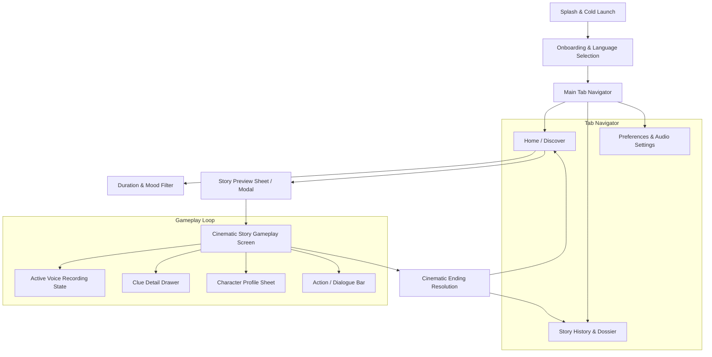
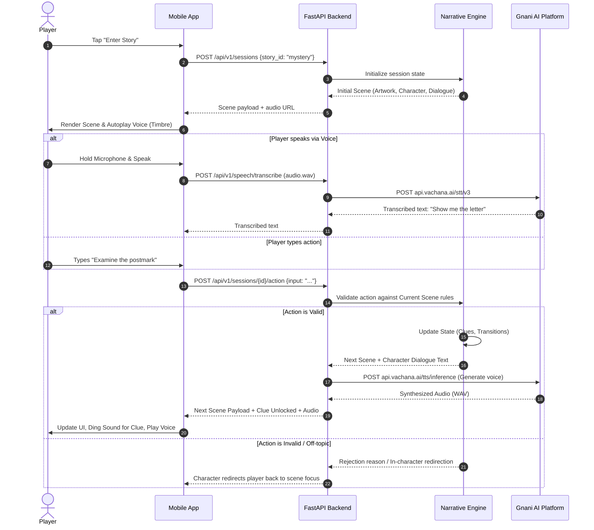

# StoryPulse AI — Mobile Application Flow & Journey Maps
**Document ID:** `03_APP_FLOW`  
**Version:** `1.0.0`  
**Status:** Approved  
**Last Updated:** 2026-11-08  

---

## 1. High-Level Navigation Architecture



---

## 2. Screen-by-Screen Specifications

### Screen 01: Splash Screen
- **Visual:** StoryPulse illuminated logo with subtle ambient gradient pulse.
- **Background Tasks:**
  - Initialize local storage session keys.
  - Verify backend connectivity (`GET /health`).
  - Warm up local audio drivers (`expo-av`).
- **Transition:** If first launch -> Screen 02 (Onboarding); Else -> Screen 04 (Home / Discover).

### Screen 02: Onboarding & Value Proposition
- **Carousel Steps:**
  1. *Turn Micro-Moments into Movies:* Experience vivid cinematic worlds during your 5-minute commute.
  2. *Speak Naturally:* Converse directly with characters in English or Telugu.
  3. *Uncover Ground Truth:* Investigate real clues where your choices decide the ending.
- **CTA:** "Begin My First Journey".

### Screen 03: Language & Voice Preference Setup
- **Options:** English (Indian accent), Telugu, Hindi.
- **Voice Mode:** Voice-First (TTS auto-play enabled) vs. Silent Reader (subtitles with manual tap-to-play).

### Screen 04: Home / Discover (The Heart of StoryPulse)
- **Header:** "StoryPulse" branding + User Greeting ("Good morning, Ananya") + Quick stats.
- **Duration Chips:** `[ 2 min ]` `[ 5 min ]` `[ 10 min ]` `[ 15 min ]` (Single-select pill row).
- **Mood Selector:** `[ 🔍 Curious ]` `[ ⚡ Excited ]` `[ ☕ Relaxed ]` `[ 🎭 Bored ]` `[ 🌌 Adventurous ]`.
- **Recommended Story Banner:** Dynamically highlights the story best fitting the active Duration + Mood.
- **The 5 Category Cards:**
  1. *Mystery / Investigation:* Midnight blue gradient, magnifying glass emblem, featured: *The Archive of Unsent Goodbyes*.
  2. *Thriller / Suspense:* Crimson shadow gradient, featured: *Platform Zero*.
  3. *Adventure / Exploration:* Turquoise & emerald gradient, featured: *The Atlas of Borrowed Weather*.
  4. *Comedy / Fun:* Vibrant coral & canary yellow, featured: *The Department of Lost Excuses*.
  5. *Sci-Fi / Futurist:* Cyan & neon ultraviolet, featured: *The Moon Sends Voice Notes*.
- **Resume Previous Story Banner:** If an unfinished session exists, displays "Resume: The Archive of Unsent Goodbyes (Scene 2/5)".

### Screen 05: Story Preview Modal
- **Visuals:** Full-bleed cover illustration, category tag, target play duration, mood tags.
- **Narrative Hook:** 2-sentence gripping premise.
- **Key Cast:** Circular avatar portraits of main characters (e.g., Mira, Dev, The Listener).
- **CTAs:**
  - `[ Enter Story ]` (Spawns or resumes session `POST /api/v1/sessions`).
  - `[ Back / Close ]`.

### Screen 06: Cinematic Story Gameplay Screen (Core Experience)
```
+-------------------------------------------------------+
| [< Exit]    The Archive of Unsent Goodbyes    [⚙ Clues(2)] |
+-------------------------------------------------------+
|                                                       |
|             FULL-BLEED SCENE ARTWORK                  |
|       (Atmospheric lighting, location tags)           |
|                                                       |
+-------------------------------------------------------+
| [Avatar] Mira (Archivist)                             |
| "The postmark says tomorrow, Ananya. That should be   |
| impossible... unless you remember writing it?"        |
| [🔊 Replay Audio]                                     |
+-------------------------------------------------------+
| RECENT DISCOVERED CLUE:                               |
| [🏷 Clue #1: Wax-Sealed Letter Dated Tomorrow]         |
+-------------------------------------------------------+
| SUGGESTED NARRATIVE ACTIONS:                          |
| [ "Examine the postmark closely" ]                    |
| [ "Ask Mira who else has access to the vaults" ]      |
+-------------------------------------------------------+
| [ ⌨ Type action... ]           [ 🎙 HOLD TO SPEAK ]    |
+-------------------------------------------------------+
```

### Screen 07: Voice Interaction State (Overlay)
- User holds down or taps the glowing central microphone.
- Dynamic audio waveform expands, giving immediate visual feedback.
- Release button -> audio snippet dispatched to `POST /api/v1/speech/transcribe`.
- Animated "Transcribing with Gnani Prisma..." pill displayed.
- On success, transcribed text appears in dialogue field and triggers narrative state transition.

### Screen 08: Clue Dossier Drawer
- Slides in from bottom/right.
- Shows locked vs. unlocked clues with high-resolution thumbnail icons, discovery timestamp, and clue lore.
- Clicking an unlocked clue displays full text investigation notes.

### Screen 09: Cinematic Ending Resolution
- Full-screen conclusion artwork.
- Epilogue narrative text detailing the consequence of the player's choices.
- Breakdown:
  - Ending Achieved (e.g., "Ending 1 of 3: The Archivist's Secret").
  - Clues Collected (e.g., 4 / 5).
  - Time elapsed (e.g., 6 mins 42 secs).
- Actions: `[ View Epilogue Summary ]`, `[ Try Alternate Ending ]`, `[ Return to Home ]`.

---

## 3. Detailed Journey Flows (Mermaid)

### 3.1 Gameplay Interaction Loop



---

## 4. Error Handling & Interrupted Sessions

1. **Network Drop During Gameplay:**
   - Client detects offline state; shows non-blocking amber toast: "Connection lost. Actions saved locally."
   - Retries with exponential backoff on reconnection (`POST /api/v1/sessions/{id}/action`).
2. **App Backgrounding / Incoming Call:**
   - `AppState` listener immediately caches active session timestamp and current scene ID to `AsyncStorage`.
   - On foreground return, prompts player: "Resume your conversation with Mira?"
3. **Gnani Service Timeout / Missing Key:**
   - If audio transcription or synthesis times out (`> 4000ms`), system falls back to text subtitles instantly without stalling the story.

