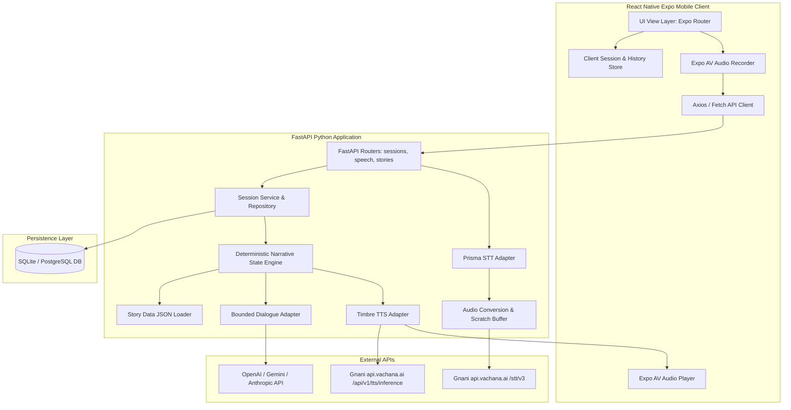

# StoryPulse AI — System Architecture & Component Interaction
**Document ID:** `08_SYSTEM_ARCHITECTURE`  
**Version:** `1.0.0`  
**Status:** Approved  
**Last Updated:** 2026-11-08  

---

## 1. End-to-End System Block Diagram

---

## 2. Component Boundaries & Responsibilities

### 2.1 Mobile Client Layer (`mobile/`)
- Captures touch events, text input, and microphone audio.
- Maintains local optimistic UI updates for rapid player feedback.
- Renders full-screen scene illustrations, speaker avatars, and clue discovery banners.
- Streams audio from backend synthesis endpoints or plays cached `.wav` assets.

### 2.2 API & Session Orchestration (`backend/app/api/`)
- Validates request payloads using Pydantic v2 schemas.
- Handles user identity via crypto-secure session tokens.
- Dispatches speech processing requests asynchronously.

### 2.3 Narrative Engine (`backend/app/services/narrative/`)
- Loads canonical JSON story packages into verified memory graphs.
- Enforces strict state transitions:
  - Transition allowed ONLY if prerequisites (required clues, scene sequence) are fulfilled.
  - Automatically unlocks discovery clues and updates relationship scores.
  - Computes ending conditions (Ending 1, 2, or 3) when reaching terminal scenes.

### 2.4 Gnani AI Integration Layer (`backend/app/services/gnani/`)
- Encapsulates network communication with `https://api.vachana.ai`.
- Injects required headers (`X-API-Key-ID`).
- Provides automatic fallback to high-fidelity mock audio / transcript when keys are unset or network fails.

