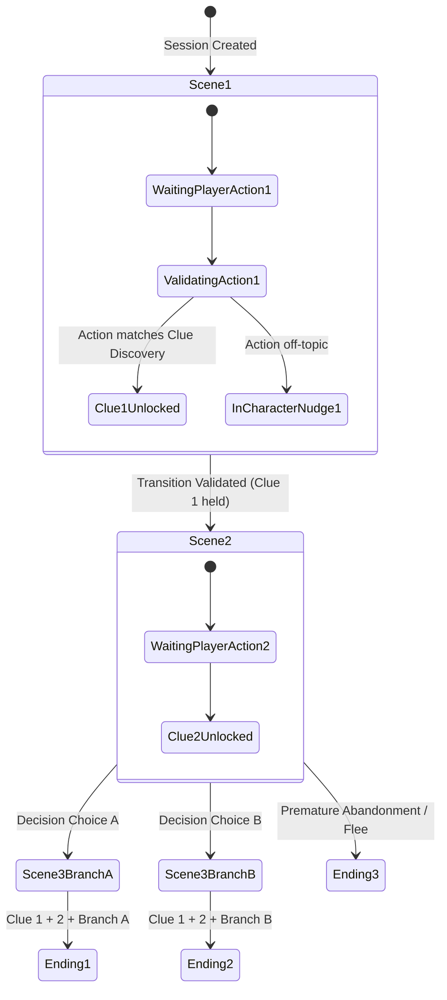

# StoryPulse AI — Narrative Engine Design & State Specification
**Document ID:** `09_STORY_ENGINE_DESIGN`  
**Version:** `1.0.0`  
**Status:** Approved  
**Last Updated:** 2026-11-08  

---

## 1. Ground Truth Principles

In traditional conversational games, using an unconstrained LLM often causes:
1. **Hallucinated Clues:** The model invents an item not recognized by the plot engine.
2. **Premature Plot Leaks:** The model accidentally reveals the killer or the twist in scene 1.
3. **Broken Ending States:** The model forgets previous decisions and delivers an incongruent ending.

**StoryPulse solves this with the Dual-Engine Architecture:**
- **Deterministic Narrative Engine:** The immutable source of truth, state transitions, clue tracking, and ending conditions.
- **Dialogue Stylist:** An LLM or structured template engine strictly bounded by the current scene's permitted knowledge boundaries.

---

## 2. State Machine Representation



---

## 3. Data Structures & Validation Logic

### 3.1 State Machine Context (`StorySessionState`)
```python
class StorySessionState:
    session_id: str
    story_id: str
    current_scene_id: str
    discovered_clues: set[str]
    completed_actions: list[str]
    character_relationships: dict[str, int] # e.g. {"mira": 1, "dev": 0}
    decision_history: list[dict]
    session_language: str
    is_completed: bool
    ending_id: Optional[str]
```

### 3.2 Action Resolution Algorithm
1. **Receive Action:** Input text string (from typed input or Gnani Prisma transcription).
2. **Keyword & Semantic Match:**
   - Check input against `current_scene.valid_transitions`.
   - Check if required clues for this transition are present in `session.discovered_clues`.
3. **If Valid Transition:**
   - Execute side-effects: unlock new clue if defined (`transition.unlocks_clue`).
   - Mutate `session.current_scene_id = transition.target_scene_id`.
   - Update `session.character_relationships`.
   - If target scene has `ending_trigger`, mark `session.is_completed = True` and set `session.ending_id`.
   - Generate response dialogue using active character's script/LLM with updated scene context.
4. **If Invalid or Ambiguous Action:**
   - Keep current scene unchanged.
   - Character responds in-character redirecting the player back to the present mystery without breaking immersion.
